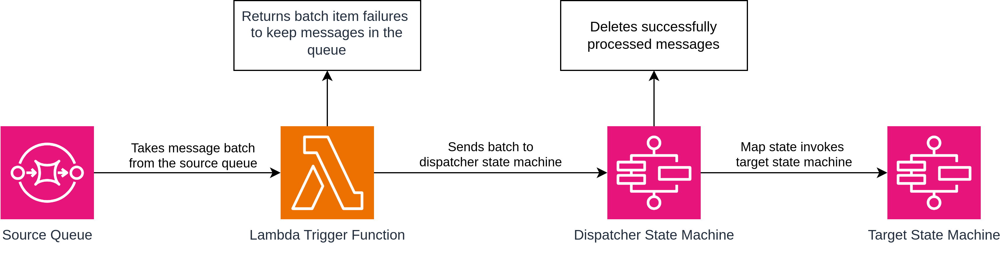

# SQS Step Functions Dispatcher

CDK construct for dispatching messages from AWS SQS to Step Functions state machines.

## Problem

Integrating Step Functions with Amazon SQS can be done in one of the following ways:

1. Create a task in state machine that retrieves messages from the queue before invoking processing logic.
2. Use EventBridge Pipes to connect queue with the state machine using Map state to process batched messages.

Either way, the state machine processing SQS messages can not not be focused purely on the business logic.

## Solution Architecture



The solution uses a singleton Lambda function that retrieves messages from the queue and forwards them to the dispatcher state machine. Then the state machine processes messages in parallel, sending each message to the target state machine and deletes successfully processed messages.

## Usage

```typescript
import { SqsStepFunctionDispatcher } from "sqs-sfn-dispatcher";

// Create a dispatcher that connects your SQS queue to your Step Function
const dispatcher = new SqsStepFunctionDispatcher(this, "MyDispatcher", {
  source: myQueue,
  target: myStateMachine,
});
```

### CDK compatibility

The construct supports `aws-cdk-lib` versions `^2.190.0` and `constructs`
versions `^10.0.0`. Both are peer dependencies, so your application supplies
the versions it uses. The package does not require an exact CDK release.

Development and the example app use CDK `2.278.0`. CI builds and tests the
construct against both CDK `2.190.0` and `2.278.0`.

The dispatcher Lambda uses the Node.js 22 runtime. Its batching, FIFO ordering,
and message deletion behavior are unchanged.

### Development

Use Node.js 22 or later and Yarn Classic:

```sh
yarn install --frozen-lockfile
yarn build
yarn test --runInBand
```

The example has its own dependencies and lockfile. Run
`yarn install --frozen-lockfile` and `yarn build` from `example/` to check it.
GitHub Actions runs the AWS integration tests with `yarn integ --force`, which
deploys and exercises them even when their snapshots have not changed.

### Working with FIFO Queues

**Important:** The SQS-SFN Dispatcher automatically sets the batch size to 1 for FIFO queues to preserve message group ordering. This ensures that:

1. Only one message per group is processed by lambda
2. If a message fails processing, subsequent messages with the same group d will not be processed until the failed message is successfully processed

Also, don't use DLQs with FIFO queues if the order of operations is critical for your application. When a message moves to a DLQ, the queue continues processing the next message in the group, breaking the ordering guarantee.

## License

This project is licensed under the Apache License 2.0.

Copyright 2023. All rights reserved.
